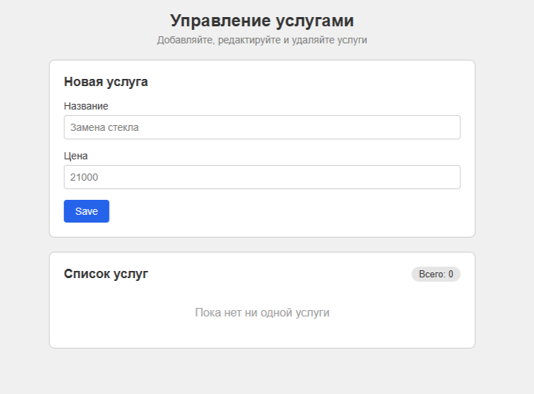

# Управление услугами (CRUD на React + Redux)

Приложение для управления списком услуг. 
Позволяет добавлять, редактировать и удалять записи, а также проверяет введенные данные на ошибки

## 📸 Скриншоты

## 🛠 Технологии

- **React**
- **TypeScript**
- **Redux**
- **Vite**
- **nanoid**
